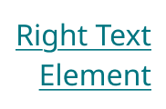
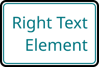

# Button Linkstyle

> Text-link styled button (used for disclosures and inline CTAs such as "Forgot password?"). Underlined brand-primary text at rest; a 1px brand-primary box appears on Hover/Pressed.

## Figma

- File: **MNG Web Design System** (`jFHYqhZbJjvWQmDI4myCsd`), page **Buttons | 2026.09.30**
- Component set: [`Button Linkstyle` · 5428:3953](https://www.figma.com/design/jFHYqhZbJjvWQmDI4myCsd/?node-id=5428-3953) · key `f2989bf6601dd76f26f1ecd1ee39d25551450390`
- Documentation frame: [Button Linkstyle — Documentation](https://www.figma.com/design/jFHYqhZbJjvWQmDI4myCsd/?node-id=7075-7436) · overview: [previews/button-linkstyle--documentation.png](previews/button-linkstyle--documentation.png)

## Properties

| Property | Default | Options |
|---|---|---|
| Style | 1 Row | 1 Row, Stacked |
| State | Default | Default, Hover, Pressed, InFocus |

## Variants

| Variant | Size | Node | Instances | Preview |
|---|---|---|---|---|
| `1 Row / Default` | 157×38 | [5428:3880](https://www.figma.com/design/jFHYqhZbJjvWQmDI4myCsd/?node-id=5428-3880) | 68 |  |
| `1 Row / Hover` | 157×38 | [5428:3882](https://www.figma.com/design/jFHYqhZbJjvWQmDI4myCsd/?node-id=5428-3882) | 1 |  |
| `1 Row / Pressed` | 157×38 | [7078:7616](https://www.figma.com/design/jFHYqhZbJjvWQmDI4myCsd/?node-id=7078-7616) | 1 |  |
| `1 Row / InFocus` | 157×38 | [5428:3884](https://www.figma.com/design/jFHYqhZbJjvWQmDI4myCsd/?node-id=5428-3884) | 1 |  |
| `Stacked / Default` | 91×60 | [5428:3881](https://www.figma.com/design/jFHYqhZbJjvWQmDI4myCsd/?node-id=5428-3881) | 0 |  |
| `Stacked / Hover` | 91×60 | [5428:3883](https://www.figma.com/design/jFHYqhZbJjvWQmDI4myCsd/?node-id=5428-3883) | 0 |  |
| `Stacked / Pressed` | 91×60 | [7078:7620](https://www.figma.com/design/jFHYqhZbJjvWQmDI4myCsd/?node-id=7078-7620) | 0 |  |
| `Stacked / InFocus` | 91×60 | [5428:3885](https://www.figma.com/design/jFHYqhZbJjvWQmDI4myCsd/?node-id=5428-3885) | 0 |  |

## Anatomy

Default variant `1 Row / Default` (hidden layers marked):

- **Style=1 Row, State=Default** `COMPONENT`: 157×38, horizontal, gap 8, padding 8/8/8/8, hug×hug
  - **Label** `TEXT`: 141×22, hug×hug, "Right Text Element", Noto Sans Regular 16px

InFocus variant `1 Row / InFocus`:

- **Style=1 Row, State=InFocus** `COMPONENT`: 157×38, horizontal, gap 8, padding 8/8/8/8, hug×hug
  - **Label** `TEXT`: 141×22, hug×hug, "Right Text Element", Noto Sans Regular 16px
  - **Focus Ring** `FRAME`: 159×40, fixed×fixed, absolute

## Component tokens

From `button-linkstyle.tokens.json`. References point at system tokens (`tokens/core/`, `tokens/themes/`); the CSS variable is `--mng-` + the token path. A literal value means the Figma layer isn't bound to a token.

| Token | Value |
|---|---|
| `button-linkstyle.state-infocus.focus-ring.border-color` | `{color.gray.black}` |
| `button-linkstyle.state-infocus.focus-ring.border-radius` | `{radius.sm}` |
| `button-linkstyle.state-infocus.focus-ring.border-style` | solid |
| `button-linkstyle.state-infocus.focus-ring.border-width` | 2px |
| `button-linkstyle.base.label.color` | `{color.theme.primary}` |
| `button-linkstyle.base.label.font-family` | `{font.family.noto-sans}` |
| `button-linkstyle.base.label.font-size` | `{font.size.16}` |
| `button-linkstyle.base.label.font-weight` | `{font.weight.regular}` |
| `button-linkstyle.base.root.border-color` | `{color.theme.primary}` |
| `button-linkstyle.base.root.border-radius` | `{radius.sm}` |
| `button-linkstyle.base.root.border-style` | solid |
| `button-linkstyle.base.root.border-width` | 1px |
| `button-linkstyle.base.root.padding-bottom` | `{spacing.100}` |
| `button-linkstyle.base.root.padding-left` | `{spacing.100}` |
| `button-linkstyle.base.root.padding-right` | `{spacing.100}` |
| `button-linkstyle.base.root.padding-top` | `{spacing.100}` |

## Behavior and breakpoints

No Breakpoint property: one size at every width.

- Single size at every breakpoint. No Breakpoint property. It stays compact (38px with one line), not 40px (Karl, 2026-10-02).
- `Style=1 Row` keeps the label on one line (157×38 with sample text). `Style=Stacked` fixes the text width at 75px so the label wraps to two lines (91×60), for narrow right-aligned slots.
- **Focus ring:** InFocus adds one `Focus Ring` frame, absolutely positioned 1px outside the element, with a 2px OUTSIDE stroke bound to `color/gray/black`. It draws outside the component and never changes its size or moves anything inside or around it (a 40px button reads as 46px with the ring). In CSS: `outline: 2px solid var(--mng-color-gray-black); outline-offset: 1px;` or an absolutely positioned pseudo-element; never a border or padding change.

## Accessibility

- Keyboard focus: the `InFocus` variant shows the focus ring (see Behavior). Never remove the focus indicator.
- Text color on its background must meet WCAG AA contrast (4.5:1 for text under 18px) in every theme; theme colors change per site.
- Icons inside a labelled control are decorative (`aria-hidden`); an icon-only control needs an accessible name (`aria-label`).

## Where it is used

Scope: instances in the Figma file **MNG Web Design System** only (other files that use the library are not counted). Total: **71**.

Inside components: InLineMessage ×15, Modals ×14, ModalsCenter ×12, Form Field ×6.
Placed on pages: Modal Panels | 2025.12.29 ×14, In-Line Content Containers | 2026.01.02 ×3, Buttons | 2026.09.30 ×2.

**Built from:** no nested components.

## Production

No production selector recorded yet. Production gaps go in `production-vs-design-differences.md`.

## Known issues

1. **Margin not specified** (open spec gap, per the Figma Specifications column).
2. **4 of 8 variants have 0 instances** in the file: `Stacked / Default`, `Stacked / Hover`, `Stacked / Pressed`, `Stacked / InFocus`.

## Files

- `button-linkstyle.tokens.json`: component tokens (DTCG 2025.10).
- `button-linkstyle.html`: HTML/CSS skeleton of every variant, using the `dist/` CSS variables (open it in a browser).
- `previews/`: PNG of every variant @2x and the documentation frame.

*Generated 2026-10-14 by `scripts/component-export/export.py` (EXPORT-STANDARD.md section 7). Edit the text in `scripts/component-export/registry.json`, not here.*
