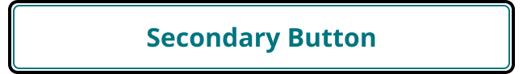
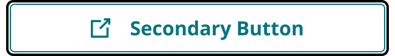
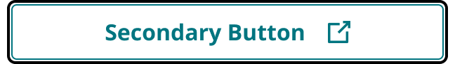

# Button Secondary

> Secondary button: white fill, 1px brand-primary border and brand-primary label. Use when actions are equal, or next to a single Primary.

## Figma

- File: **MNG Web Design System** (`jFHYqhZbJjvWQmDI4myCsd`), page **Buttons | 2026.09.30**
- Component set: [`Button Secondary` · 5333:16013](https://www.figma.com/design/jFHYqhZbJjvWQmDI4myCsd/?node-id=5333-16013) · key `6c4643d371207bf81cebfc174a02d4dac31de080`
- Documentation frame: [Button Secondary — Documentation](https://www.figma.com/design/jFHYqhZbJjvWQmDI4myCsd/?node-id=7015-36207) · overview: [previews/button-secondary--documentation.png](previews/button-secondary--documentation.png)

## Properties

| Property | Default | Options |
|---|---|---|
| Breakpoint | Desktop | Desktop, Mobile |
| Icon | None | None, Left, Right |
| State | Default | Default, Hover, Pressed, InFocus |

## Variants

| Variant | Size | Node | Instances | Preview |
|---|---|---|---|---|
| `Desktop / None / Default` | 324×40 | [5333:16014](https://www.figma.com/design/jFHYqhZbJjvWQmDI4myCsd/?node-id=5333-16014) | 1 |  |
| `Desktop / None / Hover` | 324×40 | [5401:5162](https://www.figma.com/design/jFHYqhZbJjvWQmDI4myCsd/?node-id=5401-5162) | 1 |  |
| `Desktop / None / Pressed` | 324×40 | [7015:34680](https://www.figma.com/design/jFHYqhZbJjvWQmDI4myCsd/?node-id=7015-34680) | 1 |  |
| `Desktop / None / InFocus` | 324×40 | [7015:34727](https://www.figma.com/design/jFHYqhZbJjvWQmDI4myCsd/?node-id=7015-34727) | 1 |  |
| `Desktop / Left / Default` | 324×40 | [5333:16020](https://www.figma.com/design/jFHYqhZbJjvWQmDI4myCsd/?node-id=5333-16020) | 0 |  |
| `Desktop / Left / Hover` | 324×40 | [5401:5168](https://www.figma.com/design/jFHYqhZbJjvWQmDI4myCsd/?node-id=5401-5168) | 0 |  |
| `Desktop / Left / Pressed` | 324×40 | [7015:34686](https://www.figma.com/design/jFHYqhZbJjvWQmDI4myCsd/?node-id=7015-34686) | 0 |  |
| `Desktop / Left / InFocus` | 324×40 | [7015:34734](https://www.figma.com/design/jFHYqhZbJjvWQmDI4myCsd/?node-id=7015-34734) | 0 |  |
| `Desktop / Right / Default` | 324×40 | [5333:16026](https://www.figma.com/design/jFHYqhZbJjvWQmDI4myCsd/?node-id=5333-16026) | 0 |  |
| `Desktop / Right / Hover` | 324×40 | [5401:5174](https://www.figma.com/design/jFHYqhZbJjvWQmDI4myCsd/?node-id=5401-5174) | 0 |  |
| `Desktop / Right / Pressed` | 324×40 | [7015:34692](https://www.figma.com/design/jFHYqhZbJjvWQmDI4myCsd/?node-id=7015-34692) | 0 |  |
| `Desktop / Right / InFocus` | 324×40 | [5417:3751](https://www.figma.com/design/jFHYqhZbJjvWQmDI4myCsd/?node-id=5417-3751) | 0 |  |
| `Mobile / None / Default` | 324×40 | [7015:34756](https://www.figma.com/design/jFHYqhZbJjvWQmDI4myCsd/?node-id=7015-34756) | 0 |  |
| `Mobile / None / Hover` | 324×40 | [7015:34774](https://www.figma.com/design/jFHYqhZbJjvWQmDI4myCsd/?node-id=7015-34774) | 0 |  |
| `Mobile / None / Pressed` | 324×40 | [7015:34799](https://www.figma.com/design/jFHYqhZbJjvWQmDI4myCsd/?node-id=7015-34799) | 0 |  |
| `Mobile / None / InFocus` | 324×40 | [7015:34817](https://www.figma.com/design/jFHYqhZbJjvWQmDI4myCsd/?node-id=7015-34817) | 0 |  |
| `Mobile / Left / Default` | 324×40 | [7015:34762](https://www.figma.com/design/jFHYqhZbJjvWQmDI4myCsd/?node-id=7015-34762) | 0 |  |
| `Mobile / Left / Hover` | 324×40 | [7015:34780](https://www.figma.com/design/jFHYqhZbJjvWQmDI4myCsd/?node-id=7015-34780) | 0 |  |
| `Mobile / Left / Pressed` | 324×40 | [7015:34805](https://www.figma.com/design/jFHYqhZbJjvWQmDI4myCsd/?node-id=7015-34805) | 0 |  |
| `Mobile / Left / InFocus` | 324×40 | [7015:34824](https://www.figma.com/design/jFHYqhZbJjvWQmDI4myCsd/?node-id=7015-34824) | 0 |  |
| `Mobile / Right / Default` | 324×40 | [7015:34768](https://www.figma.com/design/jFHYqhZbJjvWQmDI4myCsd/?node-id=7015-34768) | 0 |  |
| `Mobile / Right / Hover` | 324×40 | [7015:34786](https://www.figma.com/design/jFHYqhZbJjvWQmDI4myCsd/?node-id=7015-34786) | 0 |  |
| `Mobile / Right / Pressed` | 324×40 | [7015:34811](https://www.figma.com/design/jFHYqhZbJjvWQmDI4myCsd/?node-id=7015-34811) | 0 |  |
| `Mobile / Right / InFocus` | 324×40 | [7015:34792](https://www.figma.com/design/jFHYqhZbJjvWQmDI4myCsd/?node-id=7015-34792) | 0 |  |

## Anatomy

Default variant `Desktop / None / Default` (hidden layers marked):

- **Breakpoint=Desktop, Icon=None, State=Default** `COMPONENT`: 324×40, vertical, gap 8, padding 0/8/0/8, fixed×hug
  - **Button** `FRAME`: 175×40, horizontal, gap 16, padding 8/16/8/16, hug×hug
    - **Content** `FRAME`: 143×22, horizontal, gap 8, padding 0/0/0/0, hug×hug
      - **Icon Left** `INSTANCE`: 16×16, horizontal, gap 8, padding 0/0/0/0, fixed×fixed, instance of Icons (Name=new-tab), **hidden**
      - **Label** `TEXT`: 143×22, hug×hug, "Secondary Button", Noto Sans Bold 16px
      - **Icon Right** `INSTANCE`: 16×16, horizontal, gap 8, padding 0/0/0/0, fixed×fixed, instance of Icons (Name=new-tab), **hidden**

InFocus variant `Desktop / None / InFocus`:

- **Breakpoint=Desktop, Icon=None, State=InFocus** `COMPONENT`: 324×40, vertical, gap 8, padding 0/8/0/8, fixed×hug
  - **Button** `FRAME`: 175×40, horizontal, gap 16, padding 8/16/8/16, hug×hug
    - **Content** `FRAME`: 143×22, horizontal, gap 8, padding 0/0/0/0, hug×hug
      - **Icon Left** `INSTANCE`: 16×16, horizontal, gap 8, padding 0/0/0/0, fixed×fixed, instance of Icons (Name=new-tab), **hidden**
      - **Label** `TEXT`: 143×22, hug×hug, "Secondary Button", Noto Sans Bold 16px
      - **Icon Right** `INSTANCE`: 16×16, horizontal, gap 8, padding 0/0/0/0, fixed×fixed, instance of Icons (Name=new-tab), **hidden**
    - **Focus Ring** `FRAME`: 177×42, fixed×fixed, absolute

## Component tokens

From `button-secondary.tokens.json`. References point at system tokens (`tokens/core/`, `tokens/themes/`); the CSS variable is `--mng-` + the token path. A literal value means the Figma layer isn't bound to a token.

| Token | Value |
|---|---|
| `button-secondary.state-default.button.background` | `{color.gray.max}` |
| `button-secondary.state-hover.button.background` | `{color.gray.600}` |
| `button-secondary.state-pressed.button.background` | `{color.gray.600}` |
| `button-secondary.state-infocus.button.background` | `{color.gray.max}` |
| `button-secondary.state-infocus.button.focus-ring.border-color` | `{color.gray.black}` |
| `button-secondary.state-infocus.button.focus-ring.border-radius` | `{radius.sm}` |
| `button-secondary.state-infocus.button.focus-ring.border-style` | solid |
| `button-secondary.state-infocus.button.focus-ring.border-width` | 2px |
| `button-secondary.base.button.border-color` | `{color.theme.primary}` |
| `button-secondary.base.button.border-radius` | `{radius.sm}` |
| `button-secondary.base.button.border-style` | solid |
| `button-secondary.base.button.border-width` | 1px |
| `button-secondary.base.button.min-height` | 40px |
| `button-secondary.base.button.padding-bottom` | `{spacing.100}` |
| `button-secondary.base.button.padding-left` | `{spacing.200}` |
| `button-secondary.base.button.padding-right` | `{spacing.200}` |
| `button-secondary.base.button.padding-top` | `{spacing.100}` |
| `button-secondary.base.button.content.gap` | `{spacing.200}` |
| `button-secondary.base.button.content.label.color` | `{color.theme.primary}` |
| `button-secondary.base.button.content.label.font-family` | `{font.family.noto-sans}` |
| `button-secondary.base.button.content.label.font-size` | `{font.size.16}` |
| `button-secondary.base.button.content.label.font-weight` | `{font.weight.bold}` |
| `button-secondary.base.root.padding-left` | `{spacing.100}` |
| `button-secondary.base.root.padding-right` | `{spacing.100}` |
| `button-secondary.base.root.width` | 324px |
| `button-secondary.icon-left.button.content.icon-left.height` | 16px |
| `button-secondary.icon-left.button.content.icon-left.icon-color` | `{color.theme.primary}` |
| `button-secondary.icon-left.button.content.icon-left.width` | 16px |
| `button-secondary.icon-right.button.content.icon-right.height` | 16px |
| `button-secondary.icon-right.button.content.icon-right.icon-color` | `{color.theme.primary}` |
| `button-secondary.icon-right.button.content.icon-right.width` | 16px |

## Behavior and breakpoints

| Breakpoint value | Viewport (MNG templates) | Behavior |
|---|---|---|
| Desktop | ≥640px (768, 1024, 1100, 1280 templates) | The `Button` hugs its label and icons |
| Mobile | ≤639px (340 XS-Fold, 360 SM-Mobile templates) | The `Button` fills the container width, inside the 8px side margin |

*The viewport mapping is the export convention, not a Figma property; Figma only says Desktop / Mobile.*

- **Desktop** (`Breakpoint=Desktop`): the `Button` frame hugs its label and icons (HUG horizontally) inside the variant root, which keeps an 8px left/right margin. Buttons in a row or a stack keep a 16px gap.
- **Mobile** (`Breakpoint=Mobile`): the `Button` frame fills the container width (FILL) inside the same 8px margin. Stacked buttons use an 8px gap.
- **Height:** 40px in every state (8px top/bottom padding with a 40px min-height). It grows only when the label wraps to a second line.
- The breakpoint split is Desktop vs Mobile only; there are no per-template variants (340/768/1024/1100/1280). Use Mobile below 640px and Desktop from 640px up unless a layout says otherwise.
- **Focus ring:** InFocus adds one `Focus Ring` frame, absolutely positioned 1px outside the element, with a 2px OUTSIDE stroke bound to `color/gray/black`. It draws outside the component and never changes its size or moves anything inside or around it (a 40px button reads as 46px with the ring). In CSS: `outline: 2px solid var(--mng-color-gray-black); outline-offset: 1px;` or an absolutely positioned pseudo-element; never a border or padding change.

## Accessibility

- Keyboard focus: the `InFocus` variant shows the focus ring (see Behavior). Never remove the focus indicator.
- Text color on its background must meet WCAG AA contrast (4.5:1 for text under 18px) in every theme; theme colors change per site.
- Icons inside a labelled control are decorative (`aria-hidden`); an icon-only control needs an accessible name (`aria-label`).

## Where it is used

Scope: instances in the Figma file **MNG Web Design System** only (other files that use the library are not counted). Total: **4**.

**Built from:** Icons ×16
Icon variants: `new-tab` ×16.

## Production

No production selector recorded yet. Production gaps go in `production-vs-design-differences.md`.

## Known issues

1. **20 of 24 variants have 0 instances** in the file (see the Variants table).

## Files

- `button-secondary.tokens.json`: component tokens (DTCG 2025.10).
- `button-secondary.html`: HTML/CSS skeleton of every variant, using the `dist/` CSS variables (open it in a browser).
- `previews/`: PNG of every variant @2x and the documentation frame.

*Generated 2026-10-14 by `scripts/component-export/export.py` (EXPORT-STANDARD.md section 7). Edit the text in `scripts/component-export/registry.json`, not here.*
